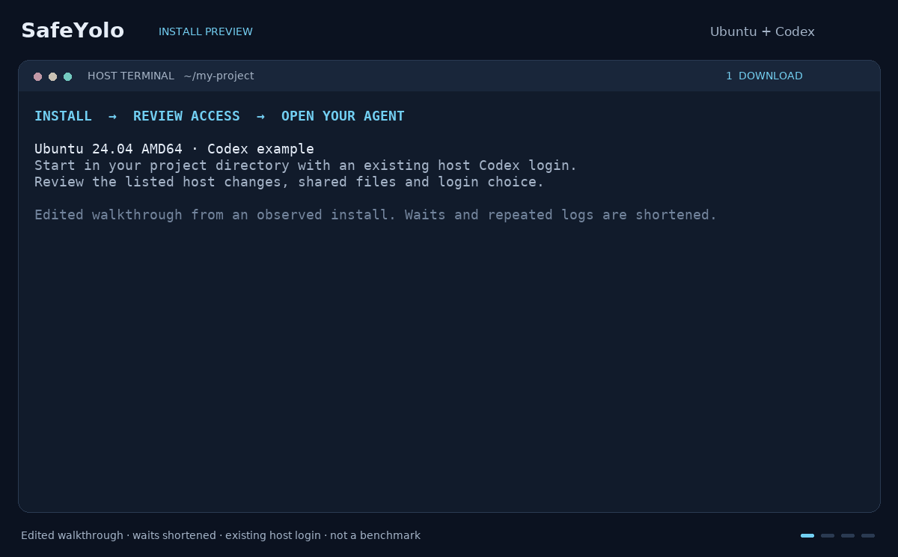

# SafeYolo

SafeYolo lets coding agents build, test and debug software with fewer
interruptions inside isolated Linux sandboxes. Share a project directory and
let the agent install tools, run commands, start services and use browsers.
You choose its file, network and service access. Works with Claude Code,
OpenAI Codex, Pi and other coding agents.

The agent can have root inside its sandbox, without root on your host.
Writable shared files are real host data: the agent can change or delete them.
Use the terminal on a workstation or headless server; the Mac GUI is optional.

[](https://github.com/craigbalding/safeyolo/actions/workflows/ci.yml)
[](https://scorecard.dev/viewer/?uri=github.com/craigbalding/safeyolo)
[](https://github.com/craigbalding/safeyolo/actions/workflows/codeql.yml)

## What you get

- A separate sandbox and persistent home for each agent: hardware-backed Linux
  microVMs on Apple Silicon macOS, rootless gVisor on Linux. See
  [storage capacity and use](docs/microvm-architecture.md#persistence) for how
  root, home and workspace use disk space.
- Mediated network access with per-agent host policies, approvals, rate budgets
  and service capabilities. Sandboxes have no external network interface.
- Host-owned service credentials and scoped credential enforcement. A network
  permission does not grant permission to send a credential.
- Operator commands for traffic, approvals, logs and diagnosis, with
  scoped exports and capture/retention limits. Commander provides the Mac GUI.
- Tools for experiments and agent coordination.

SafeYolo is pre-v1. Use the installer below; published Python CLI packages
belong to the earlier product.

**Install preview:** Edited Ubuntu 24.04 AMD64 walkthrough with Codex and an
existing host login.
Install SafeYolo and get your first agent running in less than a minute.



[Terminal walkthrough (.cast)](docs/media/install-preview.cast)

## Quick start

Use Ubuntu 24.04 AMD64 (x86_64), an ordinary sudo-enabled account, Bash, curl,
tar and an existing host Claude Code login. Open a host terminal in your own
project directory without `install-safeyolo.sh`.

You trust the project publisher. Setup uses host sudo for missing packages and
sandbox IDs, guest extraction and ownership, and AppArmor rules for the selected
runtime's user namespaces. Selected sandbox IDs get traversal to the runtime and
read/execute on its files. Setting these permissions uses sudo only on paths you
do not own. Command linking uses sudo for an unwritable parent. Host changes are
listed before consent. Run separately; stop on failure.

```sh
curl -fLO https://github.com/craigbalding/safeyolo/releases/latest/download/install-safeyolo.sh
bash install-safeyolo.sh --launch
```

Sharing and login/settings copying require consent. The sandbox can read copied
credentials. Declining setup stops launch; copying is optional. You can sign in
inside Claude. Claude skips tool prompts; read SafeYolo requests before
approving. First use can take minutes.

When Claude opens, send:

> Build and test a non-destructive command-line duplicate-file finder in
> /workspace. Have it scan by content and report duplicate groups and
> reclaimable space, without changing scanned files. Use installed tools
> without adding dependencies. Create your own sample files, run the tool
> on them inside the sandbox, and show the actual terminal results. Include
> usage instructions.

### Check the result

> Expected: passing tests and a terminal report of the sample duplicate groups
> and reclaimable bytes. The tool, tests and sample files remain in your shared
> project directory.

## Everyday commands

Follow the displayed terminal controls to return to your host. From the same
project directory, run `safeyolo agent launch` to return to Claude.
SafeYolo reuses the matching agent and its persistent home. Launching
again does not upgrade it or resubmit a task. If a task fails, inspect its
effects before submitting it again.

The agent name comes from your project directory. Use `safeyolo status`
to find it, then replace `NAME` below with the listed name. These commands
use the default installation. For another instance, use the
[custom-instance reference](docs/installation.md#other-installation-paths).

| Task | Command |
| --- | --- |
| Start or return to Claude in this project | `safeyolo agent launch` |
| Read proxy and agent state | `safeyolo status` |
| Reconnect to a running agent terminal | `safeyolo agent attach NAME` |
| Open a separate shell | `safeyolo agent shell NAME` |
| Open the running desktop | `safeyolo agent present NAME` |
| Stop the agent | `safeyolo agent stop NAME` |
| Diagnose runtime state | `safeyolo doctor` |
| Stop the proxy and its Coord runtime | `safeyolo stop` |

Stopping the proxy leaves agents running. Stop each disposable agent separately.
[Agent launchers](docs/agent-launchers.md) describe persistent terminals,
foreground runs, sandbox-only starts and explicit supervision.
[Configuration](docs/CONFIGURATION.md) describes workspace, memory, mounts,
policy, trust and operator listeners. The [CLI guide](cli/README.md) links each
command family to its current operating instructions.

## Optional workflows

| Need | Documentation |
| --- | --- |
| Manual installation, custom roots, builds or recovery | [Installation reference](docs/installation.md) |
| Try a useful task and decide its access | [Demo](docs/demo.md) |
| Controlled experiments | [The Lab](cli/README.md#lab) and [agent debugging](docs/agent-debugging.md) |
| Claim shared work or coordinate agents | [Work claims](docs/coord-operations.md#claim-durable-work), [Factories](docs/factories.md), [Coord](docs/coord-operations.md), [Mattermost](docs/coord-mattermost.md) |
| A different agent or setup | [Host scripts](contrib/HOST_SCRIPT_GUIDE.md) |
| Kali, Alpine or another rootfs | [Custom rootfs preparation](contrib/ROOTFS_SCRIPT_GUIDE.md) |
| Contained physical Mac access | [Seatbelt SSH account](contrib/macos-seatbelt-agent/README.md) |
| SafeYolo inside a Linux agent | [Nested integration lab](docs/nested-linux-lab.md) |
| Publish approved public output | [Dispatch](docs/dispatch-generation.md) |

## Trust model and reference

The host and operator are trusted; agent code may be compromised. SafeYolo
constrains agent actions, but cannot eliminate prompt injection, protect an
already compromised host or replace service authentication. Host scripts that
intentionally copy authentication into an agent have a different boundary from
host-vault service credentials. See [the security model](SECURITY.md).

- [Configuration](docs/CONFIGURATION.md) and [settings](docs/settings.md#runtime-settings)
- [Proxy architecture](docs/DEVELOPERS.md#architecture-overview) and [platform runtimes](docs/ARCHITECTURE.md#sandbox-runtime-and-networking)
- [Network routing and identity](docs/networking-vsock-uds.md)
- [Historical Python addons](docs/ADDONS.md)
- [Coord completion notes](docs/coord-completion-notes.md) and [factory proposals](docs/factory-proposals.md)
- [Contributing](docs/DEVELOPERS.md)

## License

MIT License.
