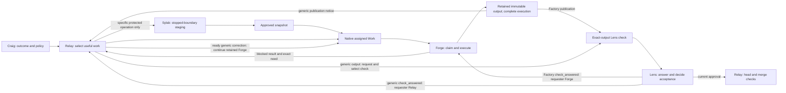

# Native software contracts and backlog adoption

The reusable [coordinator](backlog-native/coordinator.md),
[owner](backlog-native/owner.md) and [reviewer](backlog-native/reviewer.md)
contracts define native software-delivery responsibilities. The
[backlog TOML](backlog-native/backlog.toml) supplies concrete role bindings.
Repository instructions and the instance brief supply project/tool bindings;
native Work and its linked assignment supply one outcome and exact inputs.

The native workflow is assignment, claim, immutable output publication,
execution completion, exact-subject check and explicit acceptance. The
coordinator integrates the unchanged accepted candidate. Native Work has no
TASK/REVIEW_READY/terminal message mirror. The original message protocol
continues to govern any existing message assignment.

## Instance bindings

For SafeYolo work, a brief can bind the target checkout's `AGENTS.md`,
[review tools](../DEVELOPERS.md#independent-review-tools),
[publication guidance](../DEVELOPERS.md#repository-publication) and its
[acceptance graph](../../cli/src/safeyolo/agent_context/skills/safeyolo/references/graph/accept-safeyolo.yaml).
The reviewer follows those references for Cargo/Clippy, Semgrep baselines,
CodeQL qualifications and approved tool inventories. The role contract supplies
the responsibilities; this guide does not copy the tool procedures.

For example, an instance brief can state:

> For SafeYolo work, all roles use the target checkout's repository instructions.
> The reviewer uses its maintained review-tool guidance and the acceptance graph
> from the bound trusted base. The repository's publication guidance binds the
> immutable PR commit reference. Role-scoped environment locations are supplied
> separately and must be readable by their consumers. For another repository,
> use that repository's instructions and its bound tool/publication guide.

Priorities, reporting formats and declared working defaults can vary within
existing authority. An authorized change to required acceptance, role authority
or capabilities also needs coherent effective native policy/configuration;
prose alone grants nothing. Follow the factory skill's maintained
`references/design.md` separation and variation rules. Existing authorization
needs no second approval. This source guide does not activate a running factory.

## Shipped mechanisms

Native assignment, publication, Factory-generated review, acceptance and
recovery are implemented in [Factory work policy](../../proxy/src/factory/work.rs),
[publication and generated requirements](../../proxy/src/coord_rooms/work/factory_policy.rs),
[participant actions](../../proxy/src/coord_rooms/work/actions.rs),
[native supervisor recovery](../../proxy/src/coord_supervisor/native.rs),
[acceptance authority](../../proxy/src/coord_rooms/work/acceptance.rs) and
[output ownership](../../proxy/src/coord_rooms/work/outputs.rs).
Explicit further attempts use
[retained-participant continuation](../../proxy/src/coord_rooms/work/continuation.rs).
Those mechanisms do not judge software correctness, merge changes or interpret
material policy. The domain roles retain those responsibilities.

The continuation and full requirement-selection procedures below use current
shipped controls. Proposed capability extensions are not prerequisites and
must not be described as installed operations.

## Complete source contract

The maintained software contract set is [backlog.toml](backlog-native/backlog.toml),
[coordinator](backlog-native/coordinator.md), [owner](backlog-native/owner.md),
and [reviewer](backlog-native/reviewer.md). The TOML binds the software roles
to Relay, Forge and Lens for the backlog instance. `[work]` selects native delivery and per-output review. This selection
has no message handoffs or CONTEXT routes. The separate
[message example](backlog.toml) retains its declared protocol; do not run both
lifecycles for one assignment.

| Actor | Authority and required evidence |
|---|---|
| Craig | Outcomes and material policy. Canonical operator direction remains distinct from delegated agent direction. |
| Relay | Create policy-selected implementation work; coordinate checks/challenges within the approved outcome; integrate only the current Lens-approved candidate. |
| Forge | Claim assigned execution; retain, publish and correct its own output; provide focused running proof. No acceptance-policy amendment or self-acceptance. |
| Lens | Independently inspect the exact subject, answer the required check, decide acceptance and record supported issue criteria. No implementation on Forge's branch. |
| Sylab | Stage the reviewed selection and perform specific protected reads or execution. A missing host file does not transfer the whole engineering diagnosis. |

`creators=["coordinator"]` preserves Relay's assignment authority.
`authorities=["coordinator"]` permits Relay's ordinary selection of related
checks and challenges without a recurring operator gate. The contract limits
that capability to the approved outcome: it does not authorize removing issue
criteria, replacing Lens or weakening independence. The API does not enforce
those semantic limits. `deciders=["reviewer"]` and both independence flags
preserve independent acceptance. An additional challenge becomes required only
through an explicit authorized amendment; there is no automatic veto.

Selecting a Factory is explicit at work creation. Omitting `factory` creates
generic Work even in this room; the API does not require every item to select
this policy. Workers therefore verify the canonical creator and retained
selection before generic execution. The configured Relay identity or operator
can assign factory investigations; another room member does not inherit that
authority. Native checks and challenges retain their own named participants
and exact subjects.



For a source revision, enter `sym.review_revised_contract` in the factory
skill's contract-review graph. Review this TOML, all three roles and affected
references together. For live adoption, also compare the current approved and
staged identities and follow the runtime-intervention path. Source acceptance,
installed capability, approval, staging and resumed live behavior are separate
observations. This document does not establish a current live snapshot.

Native Work has no long assignment-body field. Relay retains the complete
assignment in the existing issue or a specific issue comment and links it as
`external_ref`. Both workers must be able to read it. A generic bounded Lens
investigation does not select this implementation policy: Lens cannot provide
the independent check of its own output. It remains separate evidence for the
later feature review, not a substitute acceptance route.

An execution publishes and completes before waiting for Lens. This retires its
action while retaining its producer for correction. Keeping execution pending
through a review wait would repeatedly wake the owner. Releasing an assigned
blocked execution leaves its assignee eligible for another execution action;
therefore a terminal execution attempt records its blocked/failed artifact and
completes with that limit explicit. Lens must not approve an unproved feature
because its blocker report is accurate. Optional review work is settled by its
named operation, including an abstention when evidence is missing.

## Application and rollback

Sylab applies only the independently reviewed exact commit, using the existing
owning host and instance root. The commands below are for that host, not an
agent guest. `ROOT` is the existing instance root; `PROPOSAL` is the absolute
path to the reviewed `backlog-native/backlog.toml`; `BASELINE` is the preserved
complete currently approved TOML/role set. Preserve the associated snapshot
files and normal instance backups; keep credentials and private logs private.

1. At the actual boundary, reconcile current claims, message requests, native
   actions and owned commands. Finish existing message assignments under their
   original snapshot before changing protocols. Preserve all branches and
   candidates. Pause new admissions only for the stopped staging interval.
2. Check `PROPOSAL` with the installed CLI. Stop the existing roles normally;
   do not kill healthy work or clear cursors to manufacture a boundary.
3. Approve and stage the exact reviewed selection, then resume the existing
   agents. No fresh-identity confirmation, new room, login or credential copy
   is required for this retained instance.

   ```sh
   safeyolo --root "$ROOT" factory check "$PROPOSAL"
   safeyolo --root "$ROOT" factory stop backlog
   safeyolo --root "$ROOT" factory approve "$PROPOSAL" --yes
   safeyolo --root "$ROOT" factory prepare backlog
   safeyolo --root "$ROOT" factory run backlog
   safeyolo --root "$ROOT" factory doctor backlog
   ```

   The expected result is the new approved/staged identity, the same durable
   agents, room and checkpoints, and `native_work=true` for each role. Approval
   alone does not establish staging or resumed work. The installed
   `prepare_roles` path reuses configured workspaces for existing agents.
4. Before resuming admissions, amend only the live brief clauses that mandate
   REVIEW_READY/DONE, manual attestations or correlated BLOCKED for all work.
   State that native work uses canonical mutations and existing message work
   retains its original protocol. Preserve priorities, accepted proof, exact
   acceptance and operator-only boundaries. This is a required consistency
   correction to the applied selection, not an expansion of the brief.
5. Relay assigns the next genuinely useful new outcome with the exact approved
   Factory reference and current durable assignee. Observe its real claim,
   output, generated Lens check, explicit acceptance and integration through
   existing native records. Reuse #1403/#1404 proof; do not create a synthetic
   task, full platform run or second scheduler for cutover evidence.

Existing Work retains its own policy; approval does not retrofit it.
Unassigned retained items do not wake merely because native delivery is enabled.
When a changed input makes one ready, Relay can prepare its continuation within
that same item. The operator's
existing `coord work reassign` operation can bind its actual recipient and
advance the assignment generation; agents cannot set that field themselves.
For a retained generic item, the complete continuation and correction loop is:

1. Relay retains the complete ready continuation in the existing linked
   assignment, with its input references and original findings. For completed
   assigned work, Relay as creator uses `continue_work` with current
   version/claim generation, reason, references and a chosen operation ID.
   This advances the generation and delivers `execute_work` to retained Forge.
   An unassigned item first needs operator reassignment to bind its recipient,
   as described above.
2. Forge reads that assignment and the native review records, reuses its branch
   and prior proof, publishes the new continuation output, and completes this
   execution. Publication/execution notices reach creator Relay.
3. Relay requests a Lens check of that exact output. It initially selects that
   check, Relay as amendment authority, Lens as decider and independence with
   `set_work_requirements`, using current versions. Never initially select an
   empty check list over an old partial output; acceptance would become
   actionable prematurely. On later rounds, replace only this review's old
   required check with `select_work_review`: use `review_kind=check`, the new
   check's current `{work_id, version}` and `replace_work_id` naming the prior
   selected check. Supply current work, claim and requirements expectations and
   a reason. The operation retains unrelated selections and authority. Reserve
   `set_work_requirements` for initial or deliberate full-policy selection.
4. Lens answers the check and makes its separate acceptance decision. The
   `check_answered` notice reaches requester Relay. A completed Forge is not
   the requester, creator, authority or decider in this generic route; it gets
   no correction delivery from that result. For rejection or abstention, Relay
   retains the complete findings and exact check/output identity in the linked
   assignment. Once the correction or missing input is ready, repeat step 1 on
   the same item. Do not repeat an unchanged blocked attempt.

The old item has no Factory templates: Relay explicitly requests and selects
an exact-output check after **every** generic correction publication. Explicit
same-participant continuation supplies delivery back to Forge; it does not
transfer engineering diagnosis to Sylab or introduce an approval rule.
Factory-selected work instead gives its producer the generated check's
result notice and generates each corrected output's required checks atomically.
Keep the old results, work ID, branch, independent authority and replay limits.
Do not create another item merely to attach policy or silently adopt an old
candidate or attestation as native acceptance.

For a settled blocked check that receives a genuinely new input, Relay can
select `continue_work` on that same exact-subject check. A currently required
check needs the root's current acceptance-amendment authority or the operator;
an advisory check needs its requester or the operator. Supply current
version/claim generation, the unmet need and new input references, a reason and
a chosen operation ID. The old answer remains historical, while the effective
check becomes pending and a new action reaches retained Lens. Prior approval
does not carry forward; re-evaluation needs fresh applicable acceptance. Another
output needs a new exact-subject check. Continuation grants no target permission
or authorization to repeat an uncertain external effect.

If staging or verification fails before native assignments exist, inspect the
reached state before retrying. Stop only the affected owned roles, check and
approve `BASELINE`, prepare and run that same instance, then verify the old
approved/staged identity and preserved checkpoints. If native actions already
exist, stop new admissions and reconcile them at their canonical owners first.
The supervisor refuses disabling native delivery with pending actions. Keep
native recovery enabled until those actions are genuinely settled; do not
delete receipts, cancel valid work merely to downgrade, or replay an uncertain
external effect. Old selected Work policy and immutable artifacts survive
rollback; a recovered operation receipt is not current-state proof.

## Validation boundary

Check the complete source selection with `factory check` and the repository's
focused parsing/staging, skill-render and link checks. A disposable staging
fixture proves the selected contract and native binding; it does not prove
installed production bytes, a model invocation or resumed live work. Reuse
matching behavior proof for unchanged native mechanisms. A prose-only revision
does not require a broad product rebuild or a replay of retained blocked work.

After independent source acceptance, the authorized operator executor applies
the selected revision at the planned boundary and verifies actual approved,
staged and live state. Preserve checkpoints, active work and rollback inputs.
Per-item waits and resumption inputs remain in their canonical Work and linked
assignments, not in this maintained contract guide.
