# Native Coord adoption for backlog

This is the proposed configuration for [#1532](https://github.com/craigbalding/safeyolo/issues/1532),
under Craig's canonical backlog direction 15623. It prepares a change to the
existing factory. It does not apply that change. Relay retains assignment and
integration authority, Forge implements, Lens independently accepts, and Sylab
performs the necessary operator-only application.

The proposed operator journey is: finish current message assignments, check and
approve the complete native contract, stage it while the roles are stopped,
then resume the same identities and checkpoints. Relay assigns the next useful
outcome through native Work. Forge publishes its immutable output. Lens answers
its generated check and explicitly decides acceptance. Relay integrates the
unchanged accepted head. No second message lifecycle accompanies that work.

## Compared inputs

The comparison uses installed source `67ab8285d63372c6168872b4a68b950c9329fa32`
and repository base `3be1ecf0827fdedb647fed71111216c0dd50aca9`.
The supplied nonsecret inputs are under
`/evidence/operator/coord-migration-20261112`:

- `approved-snapshot.json`, the complete resolved contracts and configuration;
- `baseline/factories/backlog.toml` and all three linked role files;
- `live-supervisors.json`, observed 12 November at 18:15:45 UTC;
- `waiting-work.json` and `operator-findings.json`.

The complete supplied TOML and linked files reproduce snapshot
`6a9b5777e7bdf802cefa12e3939934a15470384895a747ad56984430227ad689`.
Each linked role text matches the resolved snapshot. All three staged bindings
name that snapshot and report `native_work=false`. The supplied checkpoints
were idle before this assignment; they are not a live cutover clearance.
The repository's `docs/factories/backlog.toml` differs in model arguments and
repair configuration. It is not the live configuration used for this comparison.

The November 1 adoption covered claims, candidate generations, attestations,
signals and projections while preserving message routing. Accepted #1403 and
#1404 subsequently shipped native delivery and Factory-selected policy. Their
source acceptance remains accepted. The successful 15618–15622 message cycle
proves the retained message route, not adoption of those later features.

## Shipped behavior and remaining manual work

| Transition | Installed source | Live use and proposed change |
|---|---|---|
| Assignment and claim | Explicit native `assignee` selects execution delivery; the recipient claims. Unassigned open work does not wake workers. | Live TASK routes assignment separately from the native claim record. New implementation work selects the approved Factory and Forge's durable ID directly. |
| Publication | `publish_work_output` binds the authenticated producer, immutable reference, execution outcome and new target generation. | Replace the old `change_work_target` instruction with the actual publication operation. Retain the artifact first. |
| Required review | Factory publication atomically creates an exact-output check and selects it in versioned requirements. | Replace REVIEW_READY routing and its manual matching acceptance attestation for new native work. Lens claims and answers the generated check. |
| Acceptance | Only selected deciders act. Approval checks the exact current output, selected obligations and independence atomically. | Lens explicitly calls `decide_work_acceptance`; no majority, check count or execution result establishes acceptance. |
| Correction | A retained completed producer may publish a new output on the same work. Publication creates new generated checks. | Forge keeps the branch and PR. Historical checks still need their own disposition; a replacement does not cancel them. |
| Execution result | `complete_work` settles execution; `answer_check`, `respond_challenge` and `resolve_challenge` settle their own actions. | Remove text terminal responses for native delivery. Preserve blocked and failed results without calling them feature success. |
| Restart | The supervisor checkpoints native actions before receipt/cursor advancement and reconciles current actions after restart. | Keep existing checkpoints and operation IDs. Turn completion or narration cannot retire native actions. |
| Integration and policy judgment | Native records neither merge a PR nor judge the meaning of an issue or an untrusted claim. | Relay still checks the actual accepted head and merge rules. Craig still decides material policy. Lens still owns criterion acceptance. |

The governing source is [Factory work policy](../../proxy/src/factory/work.rs),
[publication and generated requirements](../../proxy/src/coord_rooms/work/factory_policy.rs),
[participant actions](../../proxy/src/coord_rooms/work/actions.rs),
[native supervisor recovery](../../proxy/src/coord_supervisor/native.rs),
[acceptance authority](../../proxy/src/coord_rooms/work/acceptance.rs), and
[output ownership](../../proxy/src/coord_rooms/work/outputs.rs).
Those mechanisms are unchanged between the installed source and this base.
The Factory staging function in `coord_setup.rs` also selects native delivery
from the presence of `[work]`; its intervening changes concern other setup paths.
The newer guided `factory setup` workflow is not needed for this proposal.

## Complete proposed contract

The deployable set is [backlog.toml](backlog-native/backlog.toml),
[coordinator](backlog-native/coordinator.md), [owner](backlog-native/owner.md),
and [reviewer](backlog-native/reviewer.md). It preserves the supplied live
agents, harness, models, reasoning settings, room and operator-input types.
It adds `[work]` and removes message handoffs and CONTEXT routes from this
selection. It does not introduce the repository example's repair route.

| Actor | Authority and required evidence |
|---|---|
| Craig | Outcomes and material policy. Canonical operator direction remains distinct from delegated agent direction. |
| Relay | Create policy-selected implementation work; coordinate checks/challenges within the approved outcome; integrate only the current Lens-approved candidate. |
| Forge | Claim assigned execution; retain, publish and correct its own output; provide focused running proof. No acceptance-policy amendment or self-acceptance. |
| Lens | Independently inspect the exact subject, answer the required check, decide acceptance and record supported issue criteria. No implementation on Forge's branch. |
| Sylab | Stage the reviewed selection and perform specific protected reads or execution. A missing host file does not transfer the whole engineering diagnosis. |

`creators=["coordinator"]` preserves Relay's assignment authority.
`authorities=["coordinator"]` permits Relay's ordinary selection of related
checks and challenges without a recurring operator gate. The contract limits
that capability to the approved outcome: it does not authorize removing issue
criteria, replacing Lens or weakening independence. The API does not enforce
those semantic limits. `deciders=["reviewer"]` and both independence flags
preserve independent acceptance. An additional challenge becomes required only
through an explicit authorized amendment; there is no automatic veto.

Selecting a Factory is explicit at work creation. Omitting `factory` creates
generic Work even in this room; the API does not require every item to select
this policy. Workers therefore verify the canonical creator and retained
selection before generic execution. The configured Relay identity or operator
can assign factory investigations; another room member does not inherit that
authority. Native checks and challenges retain their own named participants
and exact subjects.

```mermaid
flowchart LR
    Craig[Craig: outcome and policy] --> Relay[Relay: select useful work]
    Sylab[Sylab: stopped-boundary staging] --> Approved[Approved snapshot]
    Approved --> Work[Native assigned Work]
    Relay --> Work
    Work --> Forge[Forge: claim and execute]
    Forge --> Output[Retained immutable output; complete execution]
    Output --> Check[Generated exact-output check]
    Check --> Lens[Lens: answer and decide acceptance]
    Lens -->|reject: native finding| Forge
    Lens -->|current approval| Merge[Relay: head and merge checks]
    Forge -->|blocked result and exact need| Relay
    Relay -->|specific protected operation only| Sylab
```



The complete-contract review enters `sym.review_running_factory`, loads the
exact set and brief, and compares approved/staged identities. The revised-set
pass checks all three roles together. The material corrections are explicit
assignment, atomic required review, separate acceptance, and recovery without
message duplication. Exact identities, current versions, independent review
and existing security boundaries come from the shipped native contract and
operator direction. No new replay allowance, platform gate, numeric approval
rule, credential access or product policy is proposed.

Native Work has no long assignment-body field. Relay retains the complete
assignment in the existing issue or a specific issue comment and links it as
`external_ref`. Both workers must be able to read it. A generic bounded Lens
investigation does not select this implementation policy: Lens cannot provide
the independent check of its own output. It remains separate evidence for the
later feature review, not a substitute acceptance route.

An execution publishes and completes before waiting for Lens. This retires its
action while retaining its producer for correction. Keeping execution pending
through a review wait would repeatedly wake the owner. Releasing an assigned
blocked execution leaves its assignee eligible for another execution action;
therefore a terminal execution attempt records its blocked/failed artifact and
completes with that limit explicit. Lens must not approve an unproved feature
because its blocker report is accurate. Optional review work is settled by its
named operation, including an abstention when evidence is missing.

## Application and rollback

Sylab applies only the independently reviewed exact commit, using the existing
owning host and instance root. The commands below are for that host, not an
agent guest. `ROOT` is the existing instance root; `PROPOSAL` is the absolute
path to the reviewed `backlog-native/backlog.toml`; `BASELINE` is the preserved
complete currently approved TOML/role set. Preserve the associated snapshot
files and normal instance backups; keep credentials and private logs private.

1. Relay lets this proposal's current TASK and REVIEW_READY finish under the
   old snapshot. At the actual boundary, reconcile current claims, message
   requests, native actions and owned commands. Preserve all branches and
   candidates. Pause new admissions only for the stopped staging interval.
2. Check `PROPOSAL` with the installed CLI. Stop the existing roles normally;
   do not kill healthy work or clear cursors to manufacture a boundary.
3. Approve and stage the exact reviewed selection, then resume the existing
   agents. No fresh-identity confirmation, new room, login or credential copy
   is required for this retained instance.

   ```sh
   safeyolo --root "$ROOT" factory check "$PROPOSAL"
   safeyolo --root "$ROOT" factory stop backlog
   safeyolo --root "$ROOT" factory approve "$PROPOSAL" --yes
   safeyolo --root "$ROOT" factory prepare backlog
   safeyolo --root "$ROOT" factory run backlog
   safeyolo --root "$ROOT" factory doctor backlog
   ```

   The expected result is the new approved/staged identity, the same durable
   agents, room and checkpoints, and `native_work=true` for each role. Approval
   alone does not establish staging or resumed work. The installed
   `prepare_roles` path reuses configured workspaces for existing agents.
4. Before resuming admissions, amend only the live brief clauses that mandate
   REVIEW_READY/DONE, manual attestations or correlated BLOCKED for all work.
   State that native work uses canonical mutations and existing message work
   retains its original protocol. Preserve priorities, accepted proof, exact
   acceptance and operator-only boundaries. This is a required consistency
   correction to the applied selection, not an expansion of the brief.
5. Relay assigns the next genuinely useful new outcome with the exact approved
   Factory reference and current durable assignee. Observe its real claim,
   output, generated Lens check, explicit acceptance and integration through
   existing native records. Reuse #1403/#1404 proof; do not create a synthetic
   task, full platform run or second scheduler for cutover evidence.

Existing Work retains its own policy; approval does not retrofit it. The four
released waits below remain the same unassigned items and do not wake merely
because native delivery is enabled. When a changed input makes one ready,
Relay can prepare its continuation within that same item. The operator's
existing `coord work reassign` operation can bind its actual recipient and
advance the assignment generation; agents cannot set that field themselves.
For a retained generic item without selected requirements, first publish its
new continuation output. Relay then requests a Lens check of that exact output
and selects that check, Lens and independence with `set_work_requirements`,
using current versions. Never initially select an empty check list while an
old partial output exists: that would make acceptance actionable prematurely.
The old item has no Factory check templates, so this explicit check selection
is necessary. Do not create another
item merely to attach policy. Do not silently adopt its old candidate or old
attestation as native acceptance.

For a settled blocked check that receives a genuinely new input, the operator
can similarly reassign that same check to Lens at its current version and
claim generation. This clears its old answer, preserves history and creates a
new check action. It avoids an unchanged lookup, replacement feature task or
indefinite pending delivery. Relay supplies the complete new input first;
the narrow reassignment does not transfer engineering diagnosis to Sylab.

If staging or verification fails before native assignments exist, inspect the
reached state before retrying. Stop only the affected owned roles, check and
approve `BASELINE`, prepare and run that same instance, then verify the old
approved/staged identity and preserved checkpoints. If native actions already
exist, stop new admissions and reconcile them at their canonical owners first.
The supervisor refuses disabling native delivery with pending actions. Keep
native recovery enabled until those actions are genuinely settled; do not
delete receipts, cancel valid work merely to downgrade, or replay an uncertain
external effect. Old selected Work policy and immutable artifacts survive
rollback; a recovered operation receipt is not current-state proof.

## Four retained waits: next operations and inputs

These are proposed continuation operands for Relay, not assignments or native
mutations. Canonical reads on 12 November confirm the listed open/unclaimed
states. Forge has no support grants. Room membership gives Relay, Forge and
Lens send/receive access, not another role's shell or raw host administration.
The ready evidence paths below were readable in Forge's mounted namespace;
protected paths needing export are identified separately.
Relay must bind the same readable namespace for the recipient before assigning.

### #889 — original registry provenance before automatic selection

`work-55ccd434df6c4306ad76c1b2c31c8aac`, v9/claim generation 4, has no candidate.
Current signal `sig-bfc7a20d5abc419f9da71d79b1c516cc` still requests preparation
that execution 14882 already completed. The ready inputs are
`/evidence/forge/889-automatic-kvm-13947/handoff-13947.md`, its retained source
bundle and partial selection, plus `/evidence/operator/889/` receipts
`native-controller-prepared-14882.json`, `registry-and-budget-review1847.json`
and `ghcr-read-recovery-20261106T1954.json`. Native imports, compression and
the private controller setup passed. Do not repeat that preparation or carry
the old disk refusal forward as a current observation.

**Next recipient: Forge for source/transport correlation and the bounded entry
decision.** Join the original request's layers before choosing a consumer
retry. The original ORAS tags GET at 6 November 20:08:36–20:09 UTC discarded
its response metadata and bearer at exit. Earlier request
`req-25aed26554c14ce3ab4405c747887df6` and the 19:54 same-token recovery are
different observations. Canonical operator direction 13948 authorized an
appropriate recovery check, not an unlimited remint/approval loop. The current
wait's nested-allow/upstream-428 origin is still unproved.

**Narrow Sylab input:** export only the original request's sanitized nested
and outer decision/response records, caller/run and deployed-source binding,
status, request correlation and retained approval disposition. Use the known
method, host, path and UTC interval above. Do not send bearer values or private
audit files. State explicitly which fields were not retained. Forge can then
analyze the route and existing #1083 correction; raw admin access is unnecessary.
No fresh token or product replay is justified by the records presently supplied.
After a decisive changed input clears that limit, return the maintained
selector's actual compatible completed-staging selection and G/T/F operands
for Forge's whole-route fit decision. The footprint/budget recipe is already
in the readable handoff. The eventual automatic entry must select its own
inputs; preserved inner proof and whole-issue 0/6 remain unchanged. Craig
retains schedule/account/mail deployment choices.

### #1050 — server/session admission in the retained ARM fixture

`work-771c6ebe2eb94bebbb6a108a9b87b137`, v7/claim generation 2, retains output
generation 1 and the qualified production package at
`183266317dd64bd55ace11c1c76a793bf08125d0`. Package and retained-consumer proof
remain valid; the public two-command continuation is still unproved, 5/6.
Current signal `sig-6ea303b2825148c0aa15be51dffe3fe7` supersedes the one-read
need in the older signal `sig-0a935c90f12d4d17bdb993cb837d24e2`.

**Next recipient: Forge for one discriminating server-side diagnostic design.**
Ready inputs `/evidence/operator/1050/venue-recovery-0900.json` and
`ssh-phase-15533-result.json` establish TCP, identification, key exchange and
public-key authentication, followed by unconfirmed SSH session OPEN and no
guest command. They do not establish DNS, key or credential failure. The
parent VM is `79930bc5-2c99-41cf-9609-92164e239d72`; retained QEMU PID 3127,
birth 138805, forwards `127.0.0.1:22954` for user `ubuntu`. Those are recorded
operands to revalidate, not permission to stop unknown active work.

**Narrow Sylab input:** copy the already retained
`/home/agent/1104-arm712-20261111/{stage-arm-inputs.json,offline-inspection.json,readiness.json,installed-execution.json}`
from that existing parent through its authorized Rundeck route. Supply only
the launch's configured serial/guest-agent diagnostic channel metadata and
existing nonsecret server/unit results. These files are named in the 0900
receipt but their contents are not available in the current shared inputs.
Forge selects a supported decisive guest/server read from those inputs;
Sylab executes only that protected read if needed. If no such channel exists,
retain the actual capability gap until a real lifecycle/workload-stop event
permits safe recovery. No unchanged 15-minute CPU/SSH/monitor loop, reset,
new VM, installer retry or model replay follows from live QEMU alone.

### #1408 — current auth evidence versus the missing policy case

`work-791ef8efb902474ca2c0bb560d9ada14`, v3/claim generation 1, has no candidate.
C2/C3/C6/C7 remain accepted; C1/C4/C5 remain open. Current signal
`sig-0a09a1bb3d9b41eba1fe52a7e09aed48` and
`/evidence/operator/1408-1883d95e-witness/{binding-20261112.json,recovery-20261112.json,policy-result.json,result.json}`
are ready. The current selection is `k1408`, `claude/inference`, credential
label `proof-1408-fresh-20261112`, account label `agent`, destination
`api.anthropic.com`. Labels establish custody/selection, not invoice ownership.
Later policy 200/settings 404 and successful inference do not explain the
original 4 November 401.

**Next recipient: Forge for the named remaining failure case, then Lens for
independent judgment.** Reuse the current authentication helper and the
[accepted #1471 source/binding controls](https://github.com/craigbalding/safeyolo/issues/1471#issuecomment-6820373995)
where applicable: current `coding_client::authenticate` refuses unavailable
or revoked service access before client execution with an actionable error.
The old wrapper's uncaptured exit 4 is a different producer and is not proof
of that current behavior. This source/consumer distinction can narrow C5's
remaining evidence without another successful model request. Lens must still
judge its applicability; required-policy failure is not proved by those controls.

**Exact missing input:** an applicable existing intentionally required-policy
configuration and its failure output, or new original failing-request
provenance identifying the actual setup, endpoint, auth source and rejection
layer. Sylab supplies only that nonsecret selection/result when available.
No such concrete case is established by the supplied receipts. Do not create
a `forceRemoteSettingsRefresh` requirement, expand Remote Control scope,
repeat doctor/login/model runs or search again for the same absent 401. The
remaining cause is technical uncertainty, not a newly evidenced Craig action.

### #1425 — request-specific substitution and consumed binding

`work-f177f1c0de1d4eb094c0774e1de9ad78`, v3/claim generation 1, has no candidate.
This is the separate evidence diagnosis linked to
[the integration comment](https://github.com/craigbalding/safeyolo/issues/1425#issuecomment-6660321472),
not unfinished #1425 source acceptance. All ten accepted criteria and its
closed state stand. Current signal
`sig-a35104d60f054039ab10f6d2ee38e700` retains the earlier attempted read and
operator recovery of audit lines 35752–35863. Those observations bind requests
`req-02c9805ebcfc446083fe980d343f249d` and
`req-6c6a2baf0176403485d5b7abab19a2c2` to run
`4e0cf99f639f432e9249c557d7fac52c` and an unknown-secret refusal. They do not
establish exact-request substitution, consumed credential selection or the
detected value's origin. The current configured inference binding alone
cannot supply historical provenance.

**Next recipient: Forge for correlation of the actual historical producer
with the original nonsecret records.** The ready operands are that canonical
signal and issue comment. **Narrow Sylab input:** a sanitized request-specific
substitution/consumed-binding event if retained, or the exact deployed proxy,
wrapper and nonsecret auth-selection/configuration identities needed to judge
what the original records can establish. Report absent historical fields and
their coverage honestly. The earlier bounded lookup returned
`incomplete_search`; repeating it cannot prove absence. Do not copy private
audit/credentials, infer a detected value, request raw admin authority, assign
another unchanged Lens read, approve the retained refusal or run another model.
Any later decision needs the canonical approval and current effective access;
historical approval references confer neither. If the evidence was never
recorded, preserve that diagnostic limit and prepare precise observation for
the next independently authorized real consumer, without creating a replay.

## Validation and limits

This is a source/configuration comparison. No product build, model invocation,
guest execution, live Factory mutation, policy change, label change or replay
of the four waits is part of its demonstration. Existing #1403/#1404 native
API, supervised-delivery, exact-policy and restart proof remain the behavioral
evidence for those shipped mechanisms. The acceptance graph's
`ev.accept_supervisor_contract_lane` selects parsing/staging checks for this
candidate; the live recovery/model nodes would exceed this comparison's scope.
The proposed complete contract must pass `factory check` and independent
complete-set review. Operator application and actual resumed native use remain
separate observations after that review.

Forge's local check reproduced the supplied baseline snapshot exactly and
accepted the complete proposal. In an owned disposable disk-backed root,
approval followed by `safeyolo-coord factory-stage` produced the exact proposed
binding, `native_work=true`, no message handoffs and no message coordinators
for all three roles. The fixture was removed without starting an agent or
NATS. The reused CLI/helper report `commit=unknown profile=debug`; this is a
parser/staging demonstration, not qualification of installed production bytes.
The installed-source comparison and Sylab's installed `factory check` remain
distinct. No build was made to obtain a different version label.
